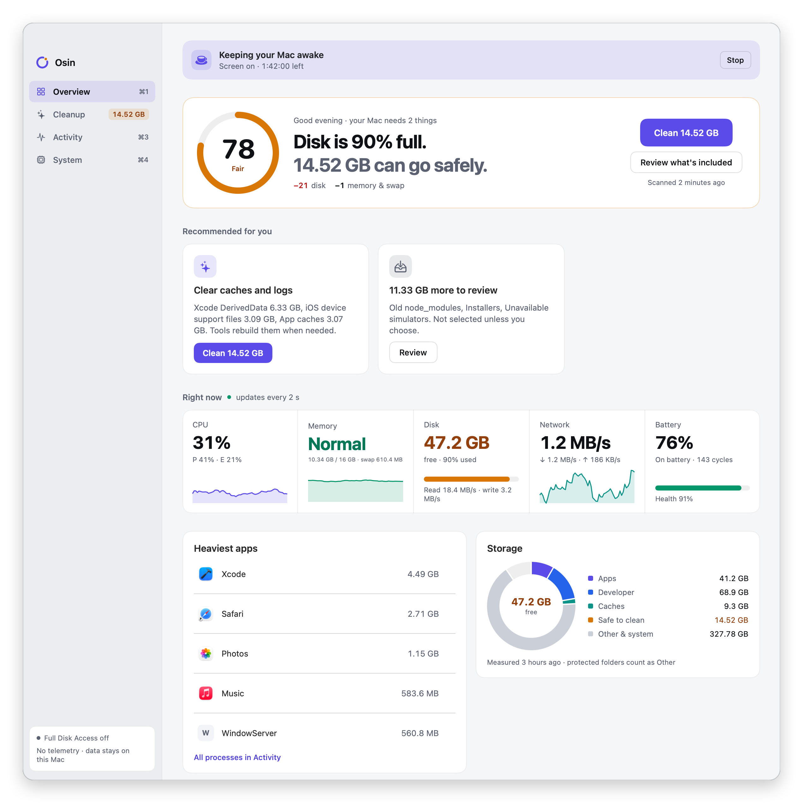
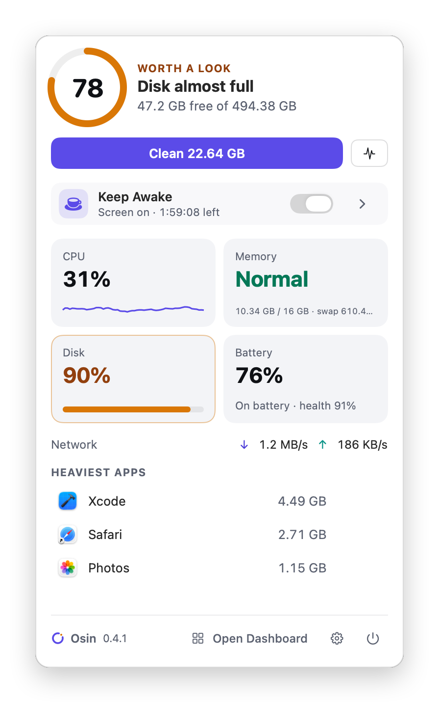
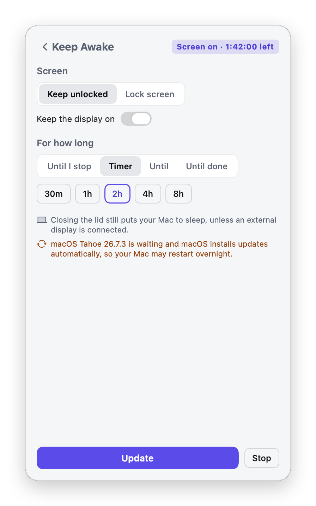
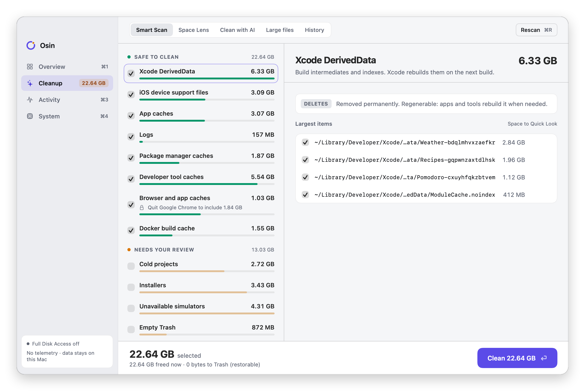
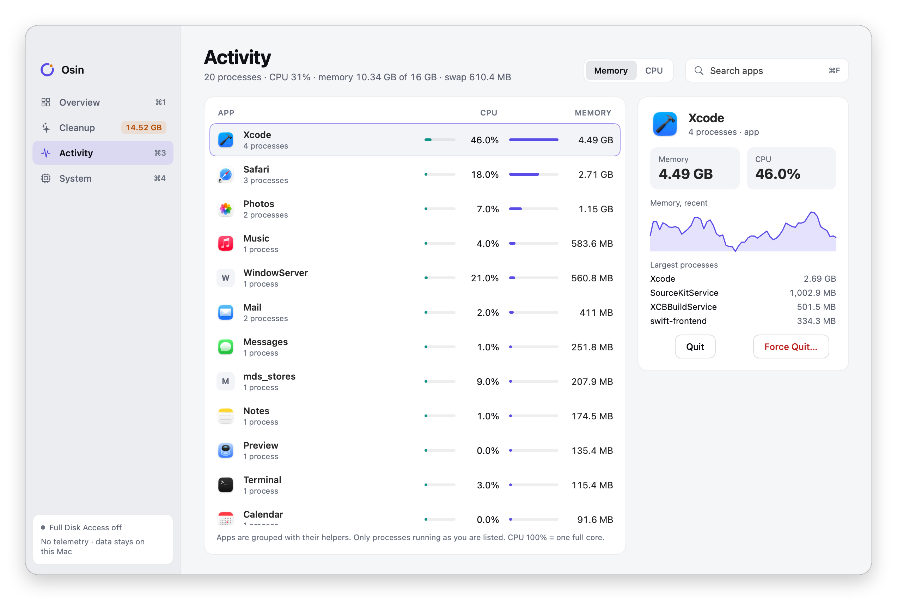
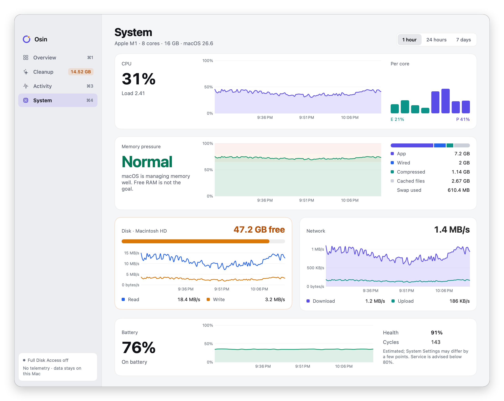

<p align="center">
  
</p>

<h1 align="center">Osin</h1>

<p align="center">
  <b>An honest health monitor and cleaner for your Mac.</b><br>
  Lives in the menu bar. Free, open source, no telemetry.
</p>

<p align="center">
  <a href="https://github.com/Vigentix/osin/releases/latest"></a>
  
  <a href="https://github.com/Vigentix/osin/actions/workflows/ci.yml"></a>
  <a href="LICENSE"></a>
</p>

<p align="center">
  <a href="#install">Install</a> ·
  <a href="#what-you-get">What you get</a> ·
  <a href="#safety-guarantees">Safety</a> ·
  <a href="#build-from-source">Build from source</a>
</p>

<picture>
  <source media="(prefers-color-scheme: dark)" srcset="docs/images/overview-dark.png">
  
</picture>

Osin tells you how your Mac is doing in plain language, frees disk space without guesswork, and keeps the Mac awake while it works for you. One **Smart Scan → Review → Clean** flow finds what is safe to remove, shows you exactly what it found, and only deletes data that rebuilds itself. Everything else goes to the Trash, where you can restore it.

It also refuses to play the "free up RAM" game. Unused memory is wasted memory, so Osin watches memory pressure, the signal macOS itself uses, and tells you which app to quit when pressure is actually high.

## Install

With [Homebrew](https://brew.sh):

```sh
brew tap vigentix/tap
brew trust vigentix/tap      # recent Homebrew versions ask you to trust third-party taps
brew install --cask osin
```

Or download `Osin-x.y.z.dmg` from [Releases](https://github.com/Vigentix/osin/releases/latest) and drag Osin to Applications.

Requires macOS 14 Sonoma or later, on Apple Silicon or Intel. English and Vietnamese.

<details>
<summary><b>First launch: macOS says it cannot verify Osin</b></summary>

<br>

Releases are not notarized yet, so macOS blocks the first launch:

1. Open Osin once and close the warning.
2. Go to **System Settings › Privacy & Security**, scroll down, click **Open Anyway** next to Osin and confirm with your password.

On macOS 15 and later, right-click › Open no longer bypasses this warning. To skip it entirely, remove the quarantine flag:

```sh
xattr -dr com.apple.quarantine /Applications/Osin.app
```

</details>

## What you get

<table>
  <tr>
    <td width="58%" valign="top">
      <h3>Health at a glance</h3>
      <p>Click the menu bar icon for a health score with the reason behind it ("Disk almost full"), CPU, memory pressure, disk, battery and network, plus the apps using the most memory. Clean in one click or jump to the dashboard.</p>
      <p>The icon's dot turns yellow or red when something needs attention. CPU, memory and network can also be shown as live text in the menu bar.</p>
      <p>Optional notifications when the disk is almost full, memory pressure stays critical, or the battery is wearing out. Osin never cleans on its own.</p>
    </td>
    <td width="42%" align="center">
      <picture>
        <source media="(prefers-color-scheme: dark)" srcset="docs/images/popover-dark.png">
        
      </picture>
    </td>
  </tr>
</table>

### Keep Awake while your Mac works

Leave a build, a download, a backup or a long script running without the Mac falling asleep. Choose to keep the screen on, or lock it right away while everything keeps running, and decide for how long: until you stop it, on a timer, until a time such as 7:00, or **until a command or app finishes**: pick `rsync`, `xcodebuild` or `python3 train.py` from the list and the Mac may sleep again once it ends.

<table>
  <tr>
    <td width="58%" valign="top">
      <p>Safety rules stop it when the battery runs low or the Mac gets hot, and you can limit it to when the power adapter is connected. You get a notification when it ends, with the reason.</p>
      <p>Keep Awake only prevents idle sleep. Closing the lid still sleeps the Mac (unless an external display is connected), and no app can block a forced restart. If a macOS update is waiting to install automatically, Osin warns you that the Mac may restart overnight.</p>
      <p>Turn it on from the menu bar, or set a global shortcut in Settings.</p>
    </td>
    <td width="42%" align="center">
      <picture>
        <source media="(prefers-color-scheme: dark)" srcset="docs/images/keepawake-dark.png">
        
      </picture>
    </td>
  </tr>
</table>

### Smart Scan you can read before you click

Osin looks for Xcode DerivedData and device support files, app caches and logs, package-manager caches, app updates that were downloaded but not installed, old `node_modules`, installers in Downloads, unavailable simulators and the Trash. Results are split into **Safe to clean** (selected for you) and **Needs your review** (never selected unless you choose), with every item listed and sizes measured on disk.

<picture>
  <source media="(prefers-color-scheme: dark)" srcset="docs/images/cleanup-dark.png">
  
</picture>

### Activity that groups apps with their helpers

Browser tabs, language servers and build services are counted with the app they belong to, so the numbers match what you can actually quit. Sort by memory or CPU, inspect the largest processes of an app, and quit it from the same place. System processes are listed but never offered for quitting.

<picture>
  <source media="(prefers-color-scheme: dark)" srcset="docs/images/activity-dark.png">
  
</picture>

### History for the last hour, day and week

CPU per core, memory pressure with its breakdown, disk throughput, network and battery charge, stored locally for seven days and downsampled so the database stays small.

<picture>
  <source media="(prefers-color-scheme: dark)" srcset="docs/images/system-dark.png">
  
</picture>

<sub>Screenshots use built-in demo data (`make screenshots`), not a real Mac.</sub>

## Safety guarantees

Osin removes files on your Mac, so these rules are enforced in code and covered by tests that run against throwaway folders:

1. **Only regenerable caches are deleted.** Everything else goes to the Trash and can be restored from the result screen or from History.
2. **Nothing outside the [rules](Packages/OsinCore/Sources/OsinCore/Rules/rules.json) is touched.** Rules are data (paths and patterns, never commands) and are limited to your home folder.
3. **Protected locations are never cleaned:** Documents, Desktop, Pictures, Movies, Music, Mail, iCloud Drive, Messages, Keychains, Safari data, `.ssh`, system folders, and any folder that contains them.
4. **Symlinks are never followed**, and every item is checked again right before it is removed.
5. **Unavailable simulators and Empty Trash cannot be undone.** They are never preselected, and Osin warns you before running them.
6. **Every action is logged** in `~/Library/Application Support/Osin/cleanup-log.jsonl`.

Osin runs in user space: no privileged helper, no kernel extension. Full Disk Access is optional and only lets the scan reach folders macOS protects, such as old device backups. The one admin action, `purge` in Settings › Advanced, asks for your password every time and explains why its effect is temporary.

## Privacy

No accounts, no analytics, no crash reporting. Metrics history and the cleanup log stay on your Mac. The only network request is the update check, which you can turn off in Settings.

## Build from source

```sh
git clone https://github.com/Vigentix/osin.git
cd osin
make bootstrap   # installs XcodeGen, SwiftLint, SwiftFormat; generates Osin.xcodeproj
make open        # opens Xcode, then run the "Osin" scheme
```

| Command | What it does |
|---|---|
| `make test` | `OsinCore` unit and integration tests |
| `make build` / `make build-release` | Debug build / universal release build (unsigned) |
| `make lint` / `make format` | SwiftFormat + SwiftLint |
| `make l10n-check` | Fails if a UI string is missing from the String Catalog |
| `make snapshots` | Renders every screen with your live data to `build/snapshots` (Debug only) |
| `make screenshots` | Renders the README screenshots with demo data to `docs/images` |
| `scripts/release.sh 0.1.0` | DMG + Sparkle ZIP; see [docs/RELEASING.md](docs/RELEASING.md) |

```
Osin/                 SwiftUI app: menu bar, dashboard, Smart Scan, settings, onboarding
Packages/OsinCore/    UI-free core: metrics sampler, health score, history, rules, scanner, cleaner
docs/                 PRD, roadmap, architecture decisions, release guide, README images
packaging/homebrew/   Homebrew cask
```

Design decisions are recorded in [docs/adr](docs/adr), and what comes next is in the [roadmap](docs/ROADMAP.md).

## Contributing

Bug reports, rule ideas and translations are welcome. See [CONTRIBUTING.md](CONTRIBUTING.md). Adding a cleanup rule for a tool you use is a good first contribution: rules are plain JSON and the safety checks run on every rule.

## License

[GPL-3.0](LICENSE)
